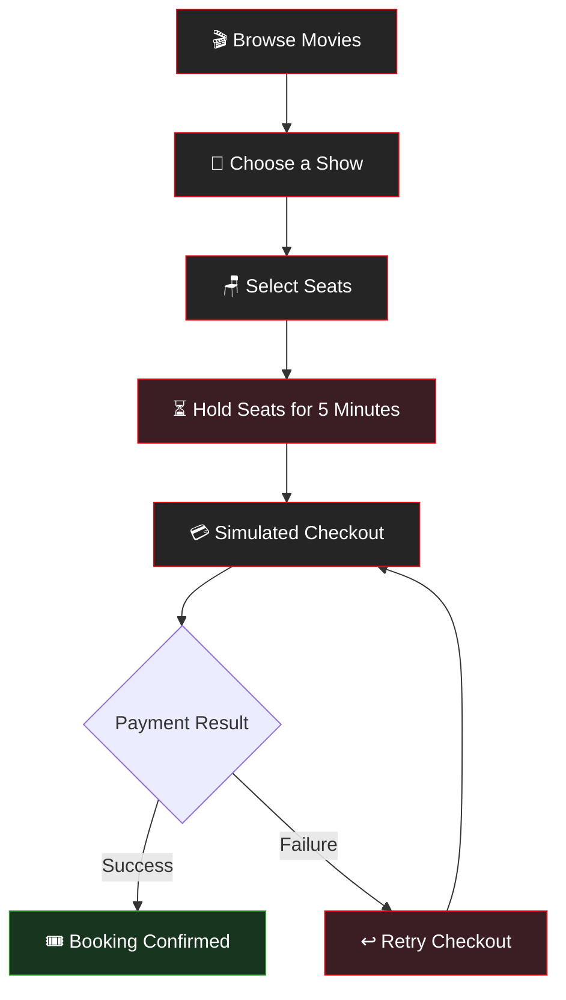
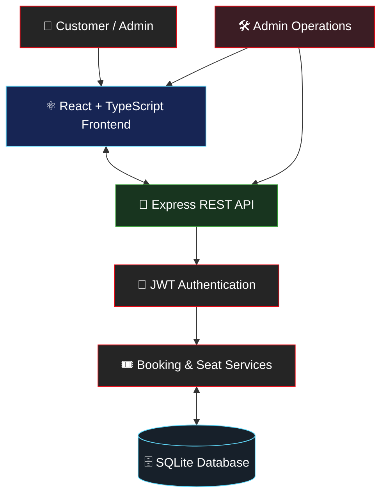

# 🎬 Yozigo Cinema — Movie Ticket Booking App

<p align="center">
  
  
  
  
  
</p>

<p align="center">
  <strong>Your seats. Your movie. Your experience.</strong>
  <br />
  A full-stack cinema ticket booking application built with React, TypeScript, Node.js, Express, and SQLite.
</p>

---

## 🍿 About the Project

**Yozigo Cinema** is a full-stack movie ticket booking application where customers can browse movies, explore upcoming shows, select seats, hold them temporarily, complete a simulated payment, and manage their bookings.

Administrators can manage movies and shows, view booking statistics, and mark damaged seats that must remain unavailable until repaired.

The application focuses on reliable seat reservations, secure booking ownership, and preventing two customers from booking the same seat.

> 🎯 **Core guarantee:** A seat cannot be booked twice for the same show.

## ✨ Features

| Feature | Description |
|---|---|
| 🔐 Authentication | Sign up, log in, log out, hashed passwords, and protected routes |
| 🎬 Movie Catalogue | Browse movies and view movie details and upcoming shows |
| 🪑 Interactive Seat Map | Select seats on an 8 × 10 seating layout |
| ⏳ Temporary Seat Holds | Hold up to 6 seats for 5 minutes with a countdown |
| 🔄 Live Seat Updates | Refresh seat availability every 3 seconds while the tab is visible |
| 💳 Simulated Payment | Test payment success and failure without a real payment gateway |
| 🎟️ Booking Management | View upcoming and past bookings |
| ❌ Booking Cancellation | Cancel eligible bookings up to 2 hours before the show |
| 🛠️ Admin Management | Create, update, and delete movies; create and manage shows |
| 📊 Admin Statistics | View booking counts, occupancy, collected amounts, and booking lists |
| 🚧 Damaged Seats | Mark seats as damaged or repair them using admin controls |
| 🛡️ Double-Booking Protection | Database constraints and transactions prevent conflicting seat reservations |

## 🎥 How Booking Works



## 🪑 Seat Reservation System

The application uses an 8-row by 10-seat layout, with rows labelled A–H and seat numbers 1–10.

- **Available:** The seat can be selected if it remains available.
- **Held:** The seat is temporarily reserved while the hold is active.
- **Booked:** The seat has been booked.
- **My seat:** A seat held by the current user.
- **Damaged:** The seat is unavailable until an administrator repairs it.

The seed data marks seat **H10** as damaged for demonstration purposes.

### 🔒 How Double Booking Is Prevented

The backend uses a `seat_locks` table with a composite primary key:

```sql
PRIMARY KEY (show_id, seat_row, seat_number)
```

This ensures that only one active lock can exist for a seat in a particular show.

Seat holds are processed inside a database transaction. If any requested seat is already taken, the operation rolls back instead of leaving a partial reservation.

When checkout succeeds, the held seats become booked within another transaction.

Expired holds are cleaned up when necessary, so seats can become available again without requiring a background job.

## 🏗️ Architecture



### 🧰 Technology Stack

| Layer | Technology |
|---|---|
| Frontend | React 19, TypeScript, Vite, React Router, CSS |
| Backend | Node.js 22, Express 5, TypeScript |
| API | REST API |
| Database | SQLite using Node.js's built-in `node:sqlite` |
| Database access | Raw SQL, transactions, constraints; no ORM |
| Authentication | JWT bearer tokens |
| Password security | bcrypt password hashes |
| Testing | Vitest and Supertest |
| Development | npm scripts |

## 📂 Project Structure

```text
cinema/
├── backend/
│   ├── src/
│   │   ├── db.ts
│   │   └── ...
│   ├── data/
│   ├── package.json
│   └── ...
├── frontend/
│   ├── src/
│   ├── package.json
│   └── ...
├── package.json
├── package-lock.json
├── .gitignore
└── README.md
```

*The source folders contain the application's backend services, frontend interface, database logic, and supporting code.*

## 🚀 Getting Started

### Prerequisites

Install:

- **Node.js 22.13 or newer** (developed with Node.js 22 and tested with Node.js 24).
- npm, which is included with Node.js.
- Git, if you want to clone the repository.

No separate database server is required. SQLite is provided through Node.js's built-in `node:sqlite` module.

### 1. Open the Project

Open a terminal in the `cinema` project directory.

If you are currently in the parent project directory, run:

```powershell
cd cinema
```

If your terminal is already inside `cinema`, skip this command.

### 2. Install Root Dependencies

```bash
npm install
```

### 3. Set Up the Application

```bash
npm run setup
```

This script installs the backend and frontend dependencies and seeds the database.

### 4. Start the Application

```bash
npm run dev
```

This starts both development servers:

| Service | URL |
|---|---|
| Frontend | http://localhost:5173 |
| Backend API | http://localhost:4000 |

Open **http://localhost:5173** in your browser.

> ⚠️ The backend must be running for the frontend to load application data. If the API is unavailable, the application displays a backend connection error.

Node.js may display an experimental warning for `node:sqlite`. This warning is expected for the configured Node.js versions.

### Alternative: Run Frontend and Backend Separately

If you prefer separate terminals, run the backend first.

**Terminal 1 — Backend**

```bash
cd backend
npm install
npm run seed
npm run dev
```

The API runs on port `4000` by default.

**Terminal 2 — Frontend**

```bash
cd frontend
npm install
npm run dev
```

The frontend runs on port `5173` by default and proxies `/api` requests to the backend.

## 🔑 Demo Accounts

The following test accounts are created by the seed script.

| Role | Email | Password |
|---|---|---|
| Admin | `admin@cinema.test` | `Admin@1234` |
| Customer | `customer@cinema.test` | `Customer@123` |

**Important:** These credentials are for local development and testing only. Never use demo credentials in a production deployment.

Administrators can only be created through the seed script. The sign-up endpoint ignores any role supplied by the client.

## 🧪 Testing

Run the backend tests:

```bash
cd backend
npm test
```

The project includes **28 backend tests** using Vitest and Supertest.

The tests cover important cases, including:

- Two users attempting to reserve the same seat.
- Database constraints preventing duplicate seat locks.
- Holds across separate database connections.
- Payment success, payment failure, and expired holds.
- Booking ownership and cancellation rules.
- Damaged-seat restrictions and repair operations.
- Admin permissions and showtime overlap checks.
- Booking statistics and show deletion rules.

To run the backend type check:

```bash
npm run typecheck
```

Run this command from the `backend` directory.

### Resetting the Seed Database

Re-running the seed script is safe and does not duplicate users or movies.

To start from a fresh local database, stop the application and delete the generated `backend/data/` directory before running setup or seeding again. This permanently removes the local database and its stored bookings.

## 🛠️ Admin Capabilities

The administrative functionality includes:

- Create, update, and delete movies.
- Add and manage showtimes.
- Reject overlapping showtimes.
- Prevent deletion of shows that have booking records.
- Review booking lists and show statistics.
- View booked seats, occupancy, and collected amounts.
- Mark seats as damaged and repair them when eligible.

A seat that is already held or booked for an upcoming show cannot be marked as damaged until the relevant bookings or holds have been resolved.

Damaged seats are unavailable across shows on the application's single screen. The backend rejects attempts to hold a damaged seat with a `409 SEAT_DAMAGED` response.

## 🔌 API Overview

The backend exposes REST endpoints for authentication, movies, shows, bookings, and administrative operations.

| Endpoint | Purpose |
|---|---|
| `POST /api/auth/signup` | Register a customer |
| `POST /api/auth/login` | Log in |
| `GET /api/auth/me` | Get the current authenticated user |
| `GET /api/movies` | List movies |
| `GET /api/movies/:id` | Get movie details and upcoming shows |
| `GET /api/shows/:id` | Get show details |
| `GET /api/shows/:id/seats` | Retrieve the seat map |
| `POST /api/shows/:id/hold` | Hold up to six seats for five minutes |
| `DELETE /api/shows/:id/hold` | Release a seat hold |
| `POST /api/shows/:id/checkout` | Complete the simulated checkout |
| `GET /api/bookings` | List the current user's bookings |
| `GET /api/bookings/:id` | Retrieve an owned booking |
| `POST /api/bookings/:id/cancel` | Cancel an eligible booking |
| `/api/admin/movies` | Administrative movie management |
| `/api/admin/shows` | Administrative show management |
| `/api/admin/damaged-seats` | Retrieve, mark, or repair damaged seats |

Protected endpoints require the appropriate authentication and authorization. Users cannot retrieve another customer's booking.

API errors use a JSON response containing an error message and, where applicable, an error code.

## 🧠 Key Engineering Decisions

### 1. SQLite Without an External Database Server

The project uses Node.js's built-in `node:sqlite` and raw SQL. This avoids a separate database installation and native database driver compilation.

### 2. Transactional Seat Holds

Seat holds are handled transactionally to prevent partial reservations. Database constraints provide an additional layer of protection against duplicate seat locks.

### 3. Expiring Holds

Each temporary hold stores an expiration timestamp. Expired holds no longer block availability and are cleaned up during subsequent operations.

### 4. Secure Booking Ownership

JWT authentication identifies the current user. The backend reloads user information from the database and enforces authorization on protected routes.

### 5. Showtime Overlap Validation

Showtime scheduling checks whether a new show overlaps an existing show. Back-to-back shows are allowed when one ends exactly as the next begins.

### 6. Live Seat Availability

The frontend polls for seat updates every three seconds while the browser tab is visible. This keeps seat availability reasonably fresh without requiring WebSockets or another persistent messaging service.

## ⚙️ Environment Configuration

The backend supports these optional environment variables:

| Variable | Purpose |
|---|---|
| `PORT` | API port; defaults to `4000` |
| `DB_PATH` | Database file location |
| `JWT_SECRET` | Secret used for JWT signing |
| `BCRYPT_ROUNDS` | Password hashing cost; defaults to `10` |

For any real deployment, configure a strong, private `JWT_SECRET`. Never commit actual secrets or production environment files to GitHub.

## ⚠️ Known Limitations

- The application models one cinema screen with 80 seats.
- Payment is simulated; no real payment provider is integrated.
- Seeded showtimes use the server's local time zone.
- The JWT is stored in `localStorage`, which has security trade-offs if an XSS vulnerability exists.
- Login rate limiting is not implemented.
- The interface is desktop-first.
- Frontend automated tests and Docker Compose are not included.
- The project does not currently have a live deployment.

## 🗺️ Future Improvements

Possible future enhancements include:

- 🎞️ Richer movie artwork and detail pages.
- 🎨 More polished seat-selection animations and visual transitions.
- 📱 Improved mobile and responsive layouts.
- 🔔 Booking confirmation notifications.
- 💳 Integration with a real payment gateway.
- ⚡ Server-Sent Events or WebSockets for real-time seat updates.
- 🧪 Expanded frontend testing and end-to-end tests.
- 🚀 Automated deployment and continuous integration.

## 🤝 Contributing

Suggestions and contributions are welcome.

1. Create a branch for your change.
2. Implement the feature or fix.
3. Run the relevant tests and type checks.
4. Review your changes before committing.
5. Open a pull request with a clear description.

## 📜 License

No license has been specified yet. Add a `LICENSE` file if you intend to distribute this project under an open-source license.

---

<p align="center">
  <strong>🍿 Pick your seats. Book your movie. Enjoy the show.</strong>
  <br />
  <em>Built with ❤️ for movie lovers.</em>
</p>
