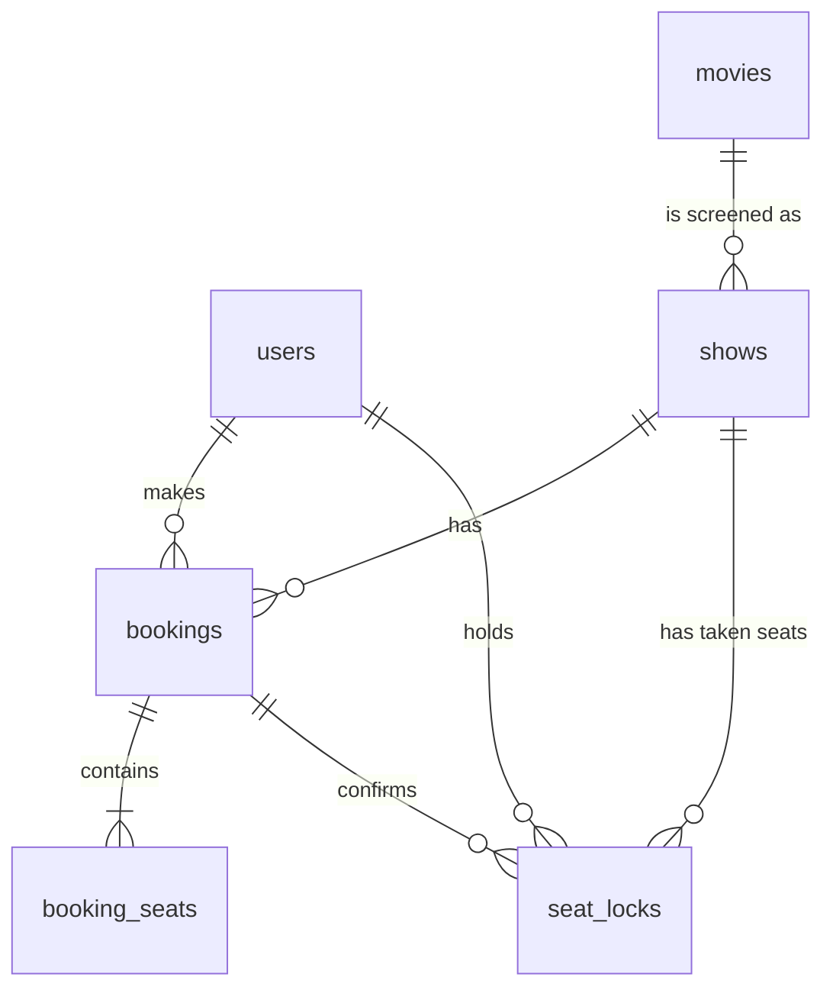

<<<<<<< HEAD
# Yozigo Cinema – Movie Ticket Booking App

Full-stack take-home: customers browse movies, pick seats on an 8×10 seat map, hold them for 5 minutes, pay (fake gateway) and get a booking. Admins manage movies and shows. **A seat can never be booked twice.**

| Layer | Choice |
|---|---|
| Frontend | React 19 + TypeScript + Vite, React Router, plain CSS |
| Backend | Node.js 22 + Express 5 + TypeScript (REST API, runs separately on port 4000) |
| Database | SQLite via Node's built-in `node:sqlite`, plain SQL, no ORM |
| Auth | Email + password (bcrypt hashes), JWT bearer tokens |
| Tests | Vitest + Supertest (28 backend tests) |

## Run it locally

Needs **Node.js 22.13 or newer** (developed on 22 and tested on 24). No database server to install and nothing to compile (SQLite is built into Node). Node prints an "ExperimentalWarning: SQLite is an experimental feature" line on start; it is harmless.

**Quickest way (from the project root, works on Windows / Mac / Linux):**

```bash
npm install          # installs the helper that runs both servers together
npm run setup        # installs backend + frontend and seeds the database
npm run dev          # starts the API (port 4000) AND the app (port 5173)
```

Then open http://localhost:5173.

**Or run the two parts separately (two terminals):**

```bash
# Terminal 1: backend
cd backend
npm install
npm run seed      # creates the DB, an admin, a test customer, 5 movies and ~20 upcoming shows
npm run dev       # API on http://localhost:4000

# Terminal 2: frontend
cd frontend
npm install
npm run dev       # app on http://localhost:5173  (Vite proxies /api to the backend)
```

The backend **must** be running, otherwise the app shows "Cannot reach the backend API".

Run the tests: `cd backend && npm test` (type-check: `npm run typecheck`).
Re-seeding is safe (it never duplicates users or movies). To start from scratch delete `backend/data/`.

Optional env vars (backend): `PORT` (4000), `DB_PATH`, `JWT_SECRET` (**set this in any real deployment**), `BCRYPT_ROUNDS` (10).

### Test logins (created by `npm run seed`)

| Role | Email | Password |
|---|---|---|
| Admin | `admin@cinema.test` | `Admin@1234` |
| Customer | `customer@cinema.test` | `Customer@123` |

Admins can only be created by the seed script; the sign-up endpoint ignores any `role` it is sent.

## What is finished

**All 10 flows (1–7 required, 8–10 bonus).**

1. Sign up / log in / log out, hashed passwords, generic login error, protected pages **and** protected API routes
2. Movie list, movie detail with upcoming shows grouped by date, started shows hidden, seats left per show
3. 8×10 seat map with "Screen this way", three seat states, loaded from the API
4. Select 1–6 seats, hold for 5 min with countdown, clear error naming the taken seat, auto-release on expiry
5. Fake payment (success / failure buttons), booking confirmation, retry after failure, rejection after expiry, no double booking (tested)
6. My bookings (upcoming first, then past), a user can never read another user's booking
7. Admin: movie CRUD, add show, overlap check, can't delete a show with bookings, admin-only API
8. Cancel up to 2 hours before the show; seats are freed immediately
9. Admin: booked/80, % full, money collected per show; booking list; same seat map
10. Live seat updates by polling every 3 seconds

**Extra feature: damaged seats.** An admin can mark a seat as damaged (or repair it) by clicking it on the admin show page. A damaged seat shows as ✕ on every show's seat map and can never be held or booked; the backend rejects it with `409 SEAT_DAMAGED` even if someone calls the API directly. A seat that is already booked or held for an upcoming show can't be marked damaged until those bookings are cancelled. The seed marks seat H10 as damaged for the demo.

Not done / known limits are listed at the bottom.

## Key decisions

- **Node + TypeScript backend**: same language as the frontend, so API types and validation rules are easy to share and reason about. Express because it is small and I wanted every route and rule visible, not hidden in a framework.
- **SQLite (Node's built-in `node:sqlite`), raw SQL**: zero setup for the reviewer (`npm install` and go, no native modules to compile, which matters on Windows). The schema uses only standard SQL (primary keys, foreign keys, CHECK constraints, transactions), so it moves to PostgreSQL with small changes (`INSERT OR IGNORE` → `INSERT … ON CONFLICT DO NOTHING`, `BEGIN IMMEDIATE` → a normal transaction). `backend/src/db.ts` is the only file that touches the SQLite driver. No ORM, so the booking logic is exactly the SQL you read.
- **How double booking is prevented**: the `seat_locks` table has `PRIMARY KEY (show_id, seat_row, seat_number)`, so the database cannot hold two rows for one seat. Holding seats runs in one `BEGIN IMMEDIATE` transaction: delete this user's old hold and any *expired* holds, then insert one row per seat; if an insert is ignored because the key already exists, the whole transaction is rolled back (all-or-nothing) and the API replies `409` naming the seats. Paying converts the same rows from `held` to `booked` inside another transaction, so nobody can slip in between hold and payment.
- **Holds expire lazily**: a hold is a row with `expires_at`. Every read ignores rows whose time has passed, and the next hold attempt deletes them. No background job, nothing to get out of sync, and expiry is exact even if the server restarts.
- **Cancel = delete lock rows**: `booking_seats` keeps the permanent record of which seats a booking had; `seat_locks` only says what is taken *right now*, so cancelling just removes the lock rows.
- **Overlap check**: `ends_at` is stored (start + movie duration). A new show clashes when `existing.start < new.end AND existing.end > new.start`. Back-to-back shows (one ends exactly when the next starts) are allowed. Editing a movie's duration re-checks its shows.
- **Auth**: JWT in the `Authorization` header, user re-loaded from the DB on each request (so a deleted user or changed role takes effect at once). Authorisation is enforced in the backend; the React guards are only for UX. Other users' bookings return `404`, not `403`, so IDs can't be probed.
- **Live updates = polling (3 s)**: simplest thing that meets "within a few seconds". It is stateless, needs no extra infrastructure, survives restarts and proxies, and the seat map is one cheap query. Server-Sent Events would reduce latency and traffic, but need a pub/sub layer once there is more than one server process. Polling pauses when the tab is hidden.
- **Times**: stored as UTC ISO strings, shown in the viewer's local time. Prices are whole rupees.

## Database design



| Table | Columns |
|---|---|
| `users` | `id` PK, `name`, `email` UNIQUE (case-insensitive), `password_hash`, `role` (`customer`/`admin`), `created_at` |
| `movies` | `id` PK, `title`, `description`, `poster_url`, `language`, `duration_minutes` (1–600), `rating` (`U`/`UA`/`A`) |
| `shows` | `id` PK, `movie_id` FK, `starts_at`, `ends_at`, `price` (> 0); CHECK `ends_at > starts_at` |
| `bookings` | `id` PK, `user_id` FK, `show_id` FK, `total_amount`, `status` (`confirmed`/`cancelled`), `created_at`, `cancelled_at` |
| `booking_seats` | PK (`booking_id`, `seat_row`, `seat_number`); `booking_id` FK. Permanent record of a booking's seats |
| `damaged_seats` | PK (`seat_row`, `seat_number`), `reason`, `marked_at`. Seats that are broken; apply to every show (one screen) |
| `seat_locks` | **PK (`show_id`, `seat_row`, `seat_number`)** ← the anti-double-booking rule. Also `user_id` FK, `status` (`held`/`booked`), `booking_id` FK (null while held), `expires_at` (only while held). CHECK keeps the held/booked fields consistent |

Seat rows are limited to A–H and numbers to 1–10 by CHECK constraints.

## API summary

| Method & path | Who | Purpose |
|---|---|---|
| `POST /api/auth/signup`, `POST /api/auth/login`, `GET /api/auth/me` | public / user | accounts |
| `GET /api/movies`, `GET /api/movies/:id`, `GET /api/shows/:id` | public | catalogue; movie detail lists only upcoming shows |
| `GET /api/shows/:id/seats` | user | seat map (`available` / `held` / `booked` / `mine`) |
| `POST /api/shows/:id/hold` · `DELETE …/hold` | user | hold up to 6 seats for 5 min / release |
| `POST /api/shows/:id/checkout` `{outcome}` | user | fake payment: `success` books, `failure` returns 402 and keeps the hold |
| `GET /api/bookings`, `GET /api/bookings/:id`, `POST /api/bookings/:id/cancel` | owner only | my bookings |
| `/api/admin/damaged-seats` (GET, POST `{seat}`, DELETE/:seat) | admin | mark / repair damaged seats |
| `/api/admin/movies` (POST, PUT/:id, DELETE/:id) · `/api/admin/shows` (GET, POST, DELETE/:id, GET/:id) | admin | management and stats |

Errors are JSON: `{ "error": "message", "code": "…" }`.

## Tests

`npm test` in `backend/` runs 28 tests against an in-memory database. The ones that matter most:

- two users racing for the same seat → exactly one `201`, one `409`, and no leftover seats for the loser
- the database itself rejects a second row for the same seat (no application code involved)
- holds from **two separate database connections** to the same file cannot overlap
- payment success / failure / paying after expiry; expired holds free the seat
- bookings are private to their owner; cancel rules (2-hour cut-off, seats freed)
- damaged seats: can't be held (all-or-nothing), shown as damaged, repair works, can't mark a booked seat, admin-only
- admin: customers get `403`, overlap rejection, can't delete a show with bookings, stats

## Assumptions and limitations

- One screen, one cinema, as specified. Seeded show times use the *server's* local time zone.
- The payment outcome is sent by the browser because the gateway is fake; a real one would call a server-verified webhook.
- A show with *any* booking row (even a cancelled one) can't be deleted, which keeps booking history intact. Shows can't be edited, only deleted and re-added.
- SQLite allows one writer at a time. That is fine for one small cinema, and is exactly why the seat logic is safe; on PostgreSQL the same primary key plus a transaction gives the same guarantee.
- The JWT lives in `localStorage` (simple, but exposed to XSS; httpOnly cookies would be the hardened alternative). No rate limiting on login.
- Desktop-first layout. No Docker Compose and no front-end automated tests.
- Not deployed (no live link).
=======
# movie-ticket-booking
>>>>>>> origin/main
